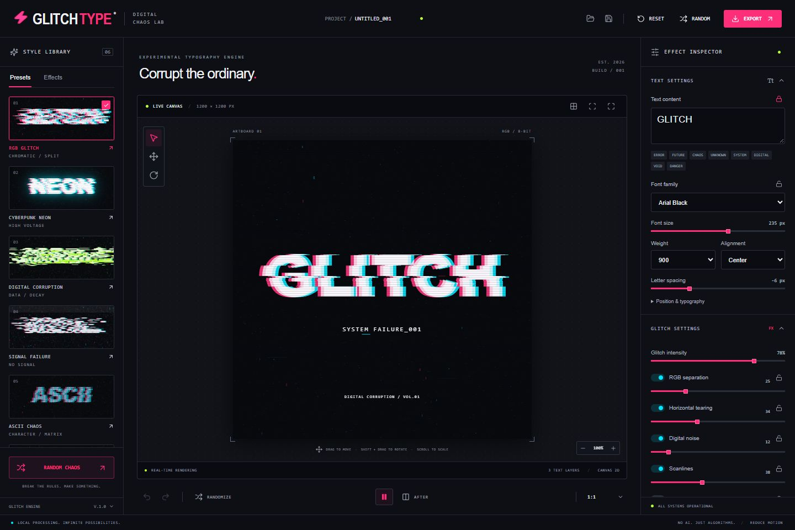

# GLITCH TYPE — Digital Chaos Lab


React + TypeScript + Vite creative typography workstation. All artwork is generated locally using Canvas 2D; no AI image service or backend is required.

## Run

```sh
npm install
npm run dev
```

Open **http://localhost:43135/**. The port is reserved in `.local-site.json` and enforced by Vite. `/health` identifies this project. `npm run build` performs strict TypeScript checks and creates `dist/`; `npm run preview` serves the build at the same port after stopping the development server. `npm test` verifies deterministic randomization, locks, effect count, and output diversity.

## Use

- Choose one of six live-rendered style previews. Switching presets retains your text.
- Select a text layer in the inspector, then edit text, font, alignment, size, spacing, leading, opacity, position, scale, and rotation. Layer controls show/hide, lock, reorder, add, and delete text.
- Drag the artwork to move text. Shift-drag or use the rotate tool to rotate. Scroll over the artwork to scale selected text. Ctrl-scroll or the zoom controls zoom the editor canvas.
- Each effect has its own enabled switch, intensity slider, and randomization lock. Advanced controls adjust slices, wave direction, frequency/speed, block dimensions/offset, scanline appearance, glow strength, noise mode, and corruption characters/mode. ASCII has density and brightness controls.
- RANDOM CHAOS selects a style, palette, and 2–5 effects. Enter a seed and click its regenerate icon for reproducible settings. Locked colors, fonts, text and effects are preserved. Recent generations can be restored from the library.
- Space toggles animation. BEFORE/AFTER compares original text. Fullscreen hides panels; Esc exits. Reduced motion is honored at startup; REDUCE MOTION pauses animation.
- Pick one of five ratios or custom dimensions (200–2400 px). Backgrounds support solid, gradient, and transparency. Six optional texture types are rendered in the artwork. The editor grid is a separate viewing aid.
- Export defaults to animated **MP4 video**: choose 3/5/10/15 seconds, 24/30 fps, HD/Full HD resolution, background, ratio, and auxiliary text. Choose 9:16 for a phone-friendly vertical video. The video is H.264 / YUV 4:2:0 in a fast-start MP4 container, with no audio. Progress and cancellation are available. Transparent artwork is composited against the selected background color.
- PNG and SVG remain available in the format menu for frozen-frame exports at 1×/2×/3×. PNG supports alpha. SVG contains a PNG of the exact composition to preserve pixel effects; it is **not editable vector typography**.
- Ctrl+S saves a JSON project. Folder icon loads it. Ctrl+Z / Ctrl+Shift+Z undo/redo editor actions outside native text fields. Text fields keep normal browser text undo behavior. Reload starts a fresh workspace; use save/open to retain work.
- On narrow screens use Styles / Canvas / Inspector tabs.

## Structure

```text
src/
  components/   ArtworkCanvas, StyleLibrary, Inspector, Controls, ExportDialog
  engine/       GlitchEngine, TextRenderer, EffectRenderer, ExportEngine, VideoExportEngine,
                random, AudioBridge
  hooks/        useProject (bounded undo/redo history)
  store/        shared types, presets, palettes, initial layers
  styles/       global.css
  App.tsx       workstation composition and keyboard shortcuts
  main.tsx      entry point
```

The renderer reuses offscreen canvases, composites RGB color layers, remaps strips for tearing/waves, samples pixels into ASCII characters, and generates seeded noise/blocks. Animation uses requestAnimationFrame with a 15 fps render cap, no React frame updates, and pauses drawing in background tabs. Device pixel ratio is respected up to the document's native resolution; exports render independently at the selected resolution. An SVG filter is used for the logo. AudioBridge is a lazy Web Audio extension point.

## V1 limitations

- SVG export embeds a raster composition rather than vector text/effects.
- Web Audio is an extension point; microphone input and audio-reactive editing are not exposed.
- MP4 encoding requires a recent Chrome/Edge browser with WebCodecs H.264 support on localhost or HTTPS. Unsupported browsers show an explicit message. Files use even dimensions and a 1920px long-edge cap for phone compatibility; no audio or alpha channel is included.
- No GIF export, cloud sync, collaboration, or arbitrary font upload.
- Fonts load from Google Fonts for the UI with local fallbacks; the artwork uses local system fonts. Project appearance may vary across OS font installations.
- Recent generations are held in memory; JSON files are the persistent project format.
